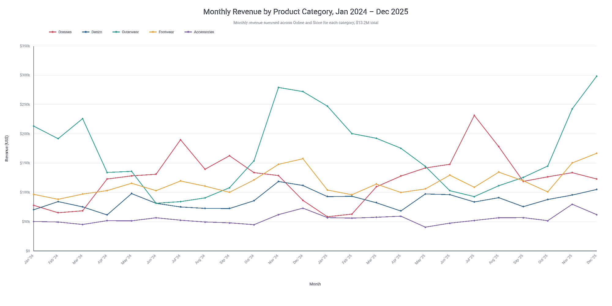
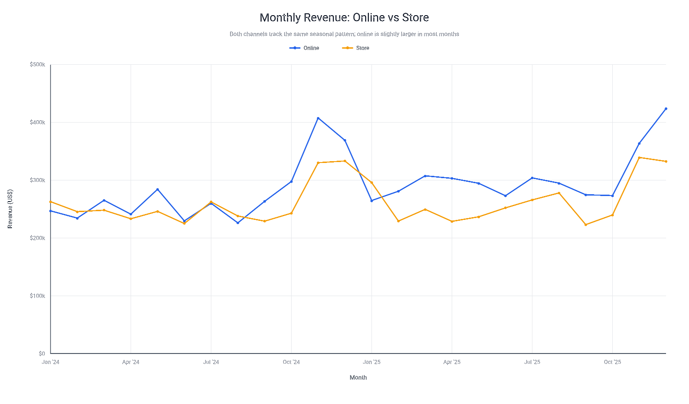
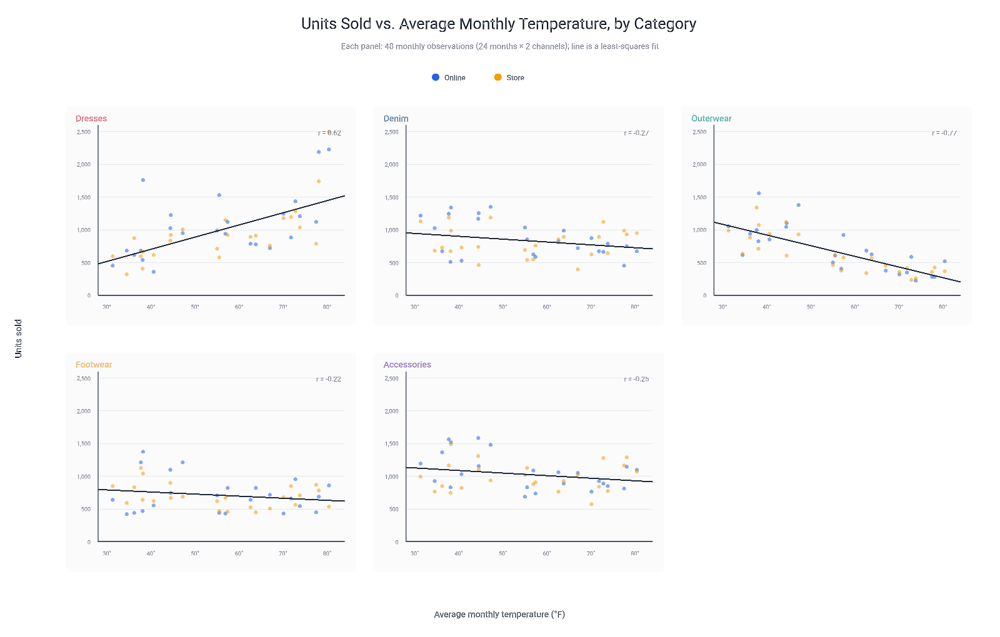
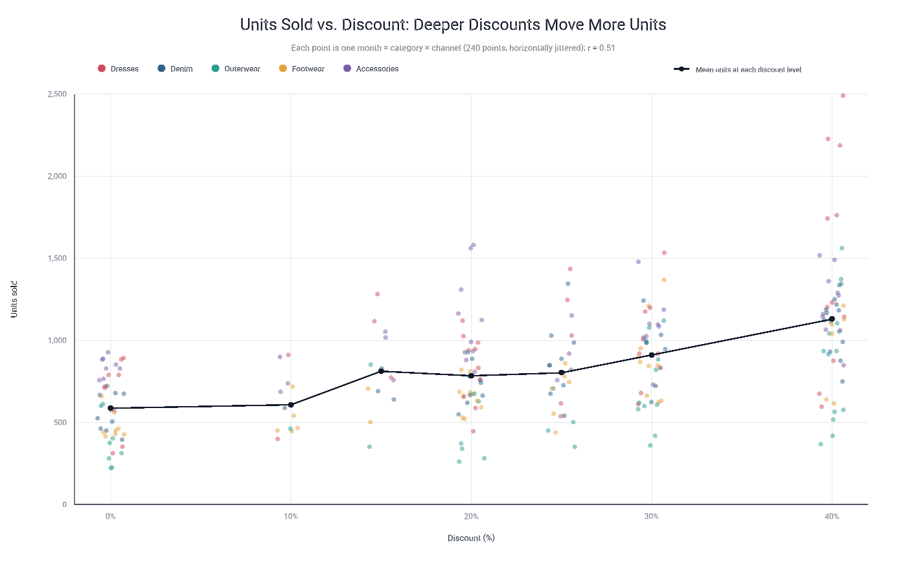
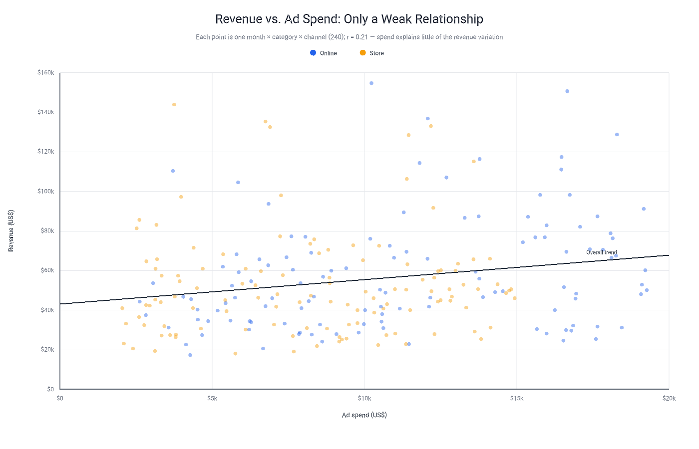
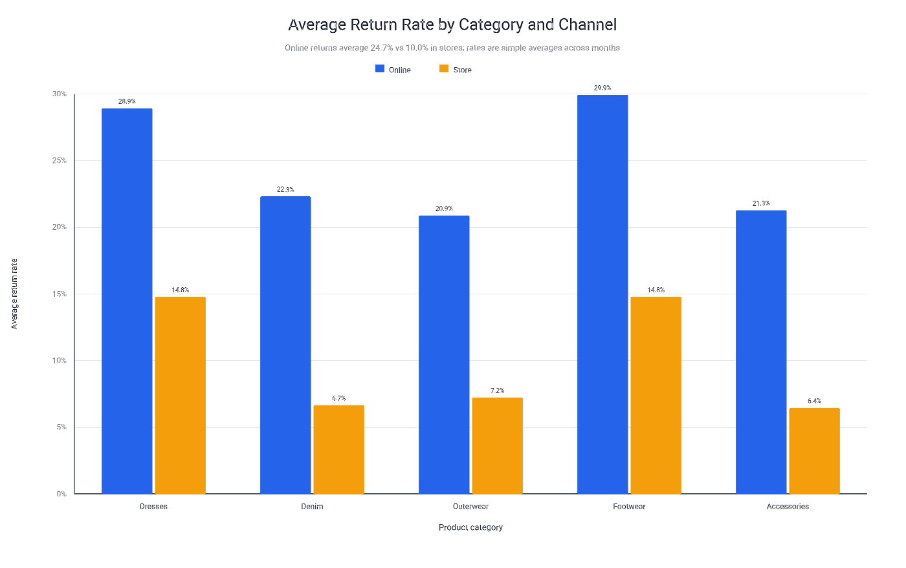

# Fashion Sales 2024–2025: Exploratory Analysis

**Data:** `fashion_sales.csv` (240 rows, 14 columns) · **Period:** January 2024 – December 2025
**Charts:** `charts/` · **Scope:** descriptive analysis; all relationships are associations, not proven causes.

---

## Executive summary

- **Outerwear produces the most revenue — $4.05M, or 30.6% of the $13.22M total — from only 15.8% of units.** Online is the larger channel at $6.97M (52.7%) versus $6.25M in stores.
- **Revenue is highly seasonal.** December 2025 was the best month ($754,943) and June 2024 the worst ($453,369), a 1.67× gap. November–December generate 21.9% of revenue in 16.7% of the months.
- **2025 grew 6.4% to $6.81M**, driven by 7.2% more units; average realized price slipped 0.8% and ad spend rose 12.9%, so revenue per ad dollar fell from about $5.83 to $5.50.
- **Online returns are the biggest quality problem: 24.7% versus 10.0% in stores.** About 35,642 units and $2.37M of gross sales were returned over two years.
- **Discounts are strongly associated with units** (r = 0.51; +10 percentage points ≈ +133 units), but much less with revenue (r = 0.20), and do **not** appear to increase returns (r = −0.10).
- **Ad spend is only weakly related to revenue** (r = 0.21, R² = 0.04). Spend is spread almost evenly across categories even though their revenue differs by 3×.
- **Temperature splits the portfolio:** Outerwear is strongly cold-weather (units r = −0.82 with temperature) while Dresses is strongly warm-weather (r = +0.68).
- **Most surprising data issue:** sale prices do not follow the stated discount reliably — 21 rows have a sale price *above* list price, all at 0% discount, up to $197.18 versus a $180 list.

---

## 1. What the dataset covers

The file is a **balanced monthly panel**. One row is:

> **one month × one product category × one sales channel**

- 24 months (Jan 2024 – Dec 2025) × 5 categories × 2 channels = **240 rows**.
- Every month has exactly 10 rows; each category appears 48 times and each channel 120 times.
- No blank cells, no duplicate rows, and no duplicate `(month, category, channel)` keys.
- Each row carries a **monthly temperature** (shared by all 10 rows in that month), a category list price, a discount decision, realized price, ad spend, ratings, units, revenue, and return rate.

The structure supports comparisons across months, categories, and channels, but **not** customer-level analysis: there is no order, product, SKU, customer, region, or cost/margin data.

## 2. Columns and how they depend on each other

| Column | What it is | Key facts |
|---|---|---|
| `month` | Month identifier, `YYYY-MM` | 24 unique months |
| `year` | Calendar year | 2024 or 2025; fully derivable from `month` |
| `month_num` | Month number 1–12 | Fully derivable from `month`; 0 mismatches |
| `category` | Product category | Dresses, Denim, Outerwear, Footwear, Accessories |
| `channel` | Sales channel | Online / Store; 120 rows each |
| `avg_temp_F` | Average monthly temperature (°F) | Month-level; range 31.3–80.4°F |
| `list_price` | Regular price ($) | Fixed per category (see below) |
| `discount_pct` | Stated discount (%) | 0, 10, 15, 20, 25, 30, or 40 |
| `sale_price` | Realized average price per unit ($) | Range $19.57–$197.18 |
| `ad_spend` | Advertising spend ($) | Range $2,050–$19,270 per row |
| `avg_rating` | Average customer rating | Range 3.4–5.0; mean 4.22 |
| `units_sold` | Units sold in the month | Range 220–2,488; mean 844 |
| `revenue` | Revenue ($) | Range $17,257–$154,512 |
| `return_rate` | Share of units returned | Range 0.01–0.36; mean 17.3% |

**Strong dependencies:**

1. **`revenue = sale_price × units_sold` exactly.** The maximum discrepancy across all 240 rows is 2.9 × 10⁻¹¹ — floating-point noise. Revenue is therefore not an independent measurement.
2. **`sale_price` is *approximately* `list_price × (1 − discount_pct/100)`.** The actual/expected ratio ranges **0.902–1.099** with mean **0.998**, i.e. roughly ±10% noise around the formula. The largest absolute gap is **$17.18**. This is why discount, price, and revenue relationships are weaker than they would be with exact pricing.
3. **`list_price` is constant within category:**

| Category | List price |
|---|---:|
| Accessories | $35 |
| Denim | $70 |
| Dresses | $85 |
| Footwear | $110 |
| Outerwear | $180 |

So `category` and `list_price` carry the same information. With only five price points, category is effectively a price tier as well as a product label.
4. **`avg_temp_F` is a month-level variable repeated in 10 rows.** Treating all 240 rows as independent observations would overstate the effective sample size for temperature. Temperature analysis below uses 24 monthly totals per category.
5. **`year` and `month_num` are redundant** with `month`. `revenue` is derived from `sale_price` and `units_sold`.

## 3. Data-quality findings

| Check | Result |
|---|---|
| Missing values | **0** across all 14 columns |
| Duplicate rows / business keys | **0** |
| Negative or zero prices, spend, units, revenue | **0** |
| `month` vs `year` / `month_num` conflicts | **0** |
| `revenue` vs `sale_price × units_sold` | Matches all 240 rows |
| `sale_price` vs list & discount formula | **All 240 rows differ by up to ±9.8%** |
| Sale price above list price | **21 rows**, all at 0% discount; max **$197.18 vs $180** (Outerwear, 2024-09) |
| Formatting | `avg_rating` is `"5"` instead of `"5.0"` once; `ad_spend` is `"8770.0"` instead of an integer once |

The above-list “sale” prices are economically impossible as discounts. The likely explanation is that `sale_price` was generated with random noise around the formula. This is the main issue to resolve before using price/discount/revenue results operationally.

---

## 4. Seasonality

Monthly total revenue averages **$550,853** with a standard deviation of **$85,147**.

| Measure | Value |
|---|---:|
| Best month | **Dec 2025 — $754,943** |
| 2nd / 3rd best | Nov 2024 — $736,471; Nov 2025 — $701,687 |
| Worst month | **Jun 2024 — $453,369** |
| 2nd / 3rd worst | Aug 2024 — $462,956; Apr 2024 — $473,209 |
| Peak ÷ trough | **1.67×** |
| Nov–Dec average | **$723,455** vs $516,333 in other months (**1.40×**) |
| Nov–Dec revenue share | **21.9%** of revenue from **16.7%** of months |

Calendar-month averages show a clear Q4 peak: December averages **$727,831**, November **$719,079**, versus June **$488,620** and February **$493,782**. The holiday lift is not just temperature — revenue peaks while temperatures are falling, which is why the overall monthly revenue–temperature correlation is only **−0.39**.

**Category seasonality** (winter = Nov–Jan, summer = May–Jul; 6 months each):

| Category | Units vs temp (r) | Revenue vs temp (r) | Winter units | Summer units | Winter ÷ summer |
|---|---:|---:|---:|---:|---:|
| Dresses | **+0.68** | **+0.85** | 1,668 | 2,717 | **−38.6%** |
| Denim | −0.35 | −0.30 | 2,151 | 1,636 | +31.5% |
| Outerwear | **−0.82** | **−0.89** | 2,214 | 836 | **+164.7%** |
| Footwear | −0.26 | −0.07 | 1,894 | 1,337 | +41.7% |
| Accessories | −0.30 | −0.34 | 2,568 | 1,931 | +33.0% |

Outerwear winter revenue averages **$258,657/month** versus **$106,835** in summer (+142.1%). Dresses does the opposite: **$161,721** in summer versus **$101,377** in winter (−37.3%). The business is therefore two seasonal engines plus three milder cold-weather lifts.

Both channels follow the same seasonal shape. Online is larger in most months and finished 2025 with a strong November–December run.

## 5. 2024 versus 2025

| Metric | 2024 | 2025 | Change |
|---|---:|---:|---:|
| Revenue | $6,406,734 | $6,813,748 | **+6.4%** |
| Units | 97,712 | 104,788 | **+7.2%** |
| Average realized price | $65.57 | $65.02 | **−0.8%** |
| Average discount | 22.88% | 22.25% | −0.63 pp |
| Ad spend | $1,098,180 | $1,239,350 | **+12.9%** |
| Revenue per ad dollar | ≈$5.83 | ≈$5.50 | **−5.7%** |
| Average return rate | 17.22% | 17.43% | +0.21 pp |
| Average rating | 4.24 | 4.20 | −0.04 |

**Growth came from volume, not price.** Revenue rose 6.4% while units rose 7.2%, and average realized price fell slightly. Ad spend grew twice as fast as revenue, so ad efficiency declined.

By channel:

| Channel | 2024 revenue | 2025 revenue | Change | Units change | Return 2024 → 2025 |
|---|---:|---:|---:|---:|---:|
| Online | $3,316,567 | $3,649,586 | **+10.0%** | +13.3% | 24.74% → 24.59% |
| Store | $3,090,167 | $3,164,162 | +2.4% | +1.0% | 9.70% → 10.27% |

Online supplied most of the growth; store growth was close to flat. Online also improved its return rate slightly, while store returns rose.

By category, 2025 revenue growth was broad but modest: Dresses **+8.7%**, Accessories **+6.7%**, Denim **+6.1%**, Outerwear **+5.5%**, Footwear **+5.1%**. Accessories had the fastest unit growth (**+9.0%**), while Outerwear’s units grew only **+3.4%** — its revenue held up through price/mix. Ten of twelve months grew year over year, averaging **+7.0%**; the weakest were October 2025 (−5.1%) and November 2025 (−4.7%), and the strongest were August 2025 (+23.5%) and June 2025 (+15.6%).

**Rating quality slipped:** overall 4.24 → 4.20, with Dresses −0.11, Denim −0.03, Outerwear −0.08; Footwear improved +0.03.

## 6. How temperature affects each category

Temperature is the cleanest split in the data, but it acts in opposite directions:

| Category | Units–temp r | Units per +10°F | R² | Interpretation |
|---|---:|---:|---:|---|
| Dresses | **+0.68** | **+372** | 0.46 | Strong summer category |
| Denim | −0.35 | −87 | 0.12 | Mild cold-weather lift |
| Outerwear | **−0.82** | **−326** | **0.68** | Strong winter category |
| Footwear | −0.26 | −64 | 0.07 | Weak seasonal effect |
| Accessories | −0.30 | −79 | 0.09 | Mild cold-weather lift |

- **Outerwear is the most temperature-sensitive category:** 68% of its monthly unit variation is linearly associated with temperature; every +10°F is associated with 326 fewer units.
- **Dresses are the mirror image:** every +10°F is associated with 372 more units, with 46% of variation explained.
- Footwear is the least temperature-sensitive (R² = 0.07): its revenue–temperature correlation is essentially zero (−0.07), so its winter unit lift (+41.7%) is offset by other factors such as price/mix.
- Accessories and Denim have mild winter lifts (+33.0% and +31.5% units), but temperature explains under 12% of their variation.

Because temperature is monthly and shared across categories, these are **descriptive seasonal associations**, not independent causal effects. Holiday demand, marketing calendars, and assortment changes move with temperature.

## 7. Do bigger discounts sell more units?

**Yes — units rise clearly with discounts, but the revenue payoff is much weaker.**

| Discount | Rows | Mean units | Median units | Mean revenue | Mean return rate |
|---:|---:|---:|---:|---:|---:|
| 0% | 43 | 586 | 577 | $48,291 | 19.21% |
| 10% | 12 | 607 | 562 | $44,764 | 19.32% |
| 15% | 13 | 812 | 773 | $56,744 | 17.59% |
| 20% | 45 | 784 | 755 | $50,519 | 16.24% |
| 25% | 28 | 802 | 768 | $50,389 | 17.25% |
| 30% | 46 | 911 | 917 | $61,826 | 16.89% |
| 40% | 53 | **1,129** | **1,124** | **$63,035** | 16.60% |

- Overall correlation between discount and units: **r = 0.51**; each +1 percentage point is associated with **+13.3 units**, or **+133 units per +10 pp**.
- The pattern survives controls: within-category correlations are **0.55–0.75** (Denim highest at 0.75), and a two-way (category + month) demeaned correlation is still **0.476**.
- It is stronger online (r = 0.59) than in stores (r = 0.45).
- But discount vs **revenue** is only **r = 0.20**, and discount vs **return rate** is **−0.10**: deeper discounts are not associated with more returns. Discount vs rating is essentially zero (−0.01).

The 40%-discount rows average **93% more units** than 0%-discount rows (1,129 vs 586) but only **30% more revenue** ($63,035 vs $48,291). Since cost of goods is not in the file, the margin impact cannot be calculated — and a 40% discount almost certainly gives up more margin per unit than a 0% discount. The data supports targeted discounting to move volume, not blanket deep discounting to grow revenue.

## 8. Does ad spending pay off?

**Only weakly, and the data cannot establish causality.**

- Total ad spend: **$2,337,530**; total revenue: **$13,220,482** → **$5.66 of revenue per $1 of ad spend** (ads equal 17.7% of revenue).
- Row-level correlation: **r = 0.21** with revenue and **0.25** with units; **R² = 0.043**, so ad spend explains about **4%** of revenue variation.
- The fitted slope is **+$1,234 of revenue per +$1,000 of ad spend**, but with very wide uncertainty and obvious reverse-causality risk.
- Within-month correlation (removing common seasonality): **r = 0.23** — still weak.

| Category | Ad spend | Revenue per $1 ad spend | Ad spend as % of revenue | Ad–revenue r |
|---|---:|---:|---:|---:|
| **Outerwear** | $474,890 | **$8.52** | **11.7%** | 0.18 |
| Dresses | $456,100 | $6.57 | 15.2% | 0.37 |
| Footwear | $452,080 | $6.18 | 16.2% | 0.61 |
| Denim | $489,100 | $4.25 | 23.5% | 0.56 |
| **Accessories** | $465,360 | **$2.81** | **35.6%** | 0.38 |

| Channel | Ad spend | Revenue per $1 | Ad–revenue r |
|---|---:|---:|---:|
| Online | $1,340,200 | $5.20 | 0.29 |
| Store | $997,330 | **$6.27** | 0.04 |

Ad budgets are nearly identical across categories (**$452k–$489k**) even though revenue ranges from **$1.31M to $4.05M**. Accessories receives almost the same budget as Outerwear but returns **$2.81 per ad dollar versus $8.52** — a 3× efficiency gap.

High-spend rows (above the $9,430 median) average **$60,336** revenue and **903 units**, versus **$49,835** and **784 units** for low-spend rows; returns are also higher (18.10% vs 16.54%). This is consistent with budgets following expected sales or online mix, not proof that spending more causes sales. The honest conclusion is: **advertising’s measured association with revenue is weak; budget allocation looks more like a fixed split than an optimized channel.**

## 9. Returns: the online problem

- Overall average return rate: **17.32%** (unit-weighted **17.60%**).
- Approximate returned volume: **35,642 units**, representing **$2,374,766 of gross sales** (18.0% of revenue). This is gross sales at risk, not lost profit.
- **Online: 24.66%** (26,017 units, $1.73M gross sales).
- **Store: 9.98%** (9,625 units, $0.64M gross sales).
- The online rate is **2.5×** the store rate.

| Category | Online return rate | Store return rate |
|---|---:|---:|
| Dresses | **28.92%** | 14.79% |
| Denim | 22.31% | 6.65% |
| Outerwear | 20.88% | 7.23% |
| Footwear | **29.94%** | 14.80% |
| Accessories | 21.27% | **6.44%** |

Every category returns more than **20.9%** online; no store category exceeds **14.8%**. The worst cells are **Footwear online (29.94%)** and **Dresses online (28.92%)**. The best are **Accessories store (6.44%)** and **Denim store (6.65%)**.

**What relates to returns (row-level correlations):**

| Variable | Correlation with return rate |
|---|---:|
| Average rating | **−0.35** |
| Ad spend | +0.23 |
| Discount | −0.10 |
| Units sold | +0.08 |
| Sale price | +0.05 |
| Temperature | −0.00 |

- **Rating is the strongest single correlate:** lower-rated rows return more. Across the 10 category–channel cells, the rating–return correlation is **−0.86**.
- The positive ad-spend correlation (+0.23) largely reflects channel mix: online gets more ad spend and has far higher returns. Within Online, ad–return is actually **−0.13**; within Store it is **−0.01**.
- Discounts are **not** associated with higher returns (r = −0.10; within most categories also weak), so discounting is not the return driver here.
- Temperature is unrelated to returns (r = −0.00), so this is not a seasonal-return story.

**Implication:** returns are primarily an **online/category** issue — especially online Footwear and Dresses — and are linked to customer satisfaction, not to discount depth.

## 10. Ratings: uniformly good, weakly diagnostic

- Mean **4.22**, median **4.20**, standard deviation **0.28**, range **3.4–5.0**.
- Category averages span only **0.07 stars**: Accessories 4.25, Dresses 4.23, Outerwear 4.23, Footwear 4.20, Denim 4.18.
- Channel gap: **Online 4.15 vs Store 4.29**.
- Ratings correlate only weakly with units (**0.13**), price (**−0.01**), discount (**−0.01**), and ad spend (**−0.09**), but more meaningfully with returns (**−0.35**).
- Ratings slipped from **4.24 to 4.20** year over year, driven by Dresses (4.28 → 4.17), Denim (4.20 → 4.17), and Outerwear (4.27 → 4.19).

The narrow range means ratings cannot explain why Outerwear earns 3× Accessories’ revenue. They are more useful as an **early-warning return signal**, particularly online.

## 11. Category and channel scorecards

### Categories

| Category | Revenue | Revenue share | Units | Unit share | Avg realized price | Avg discount | Avg return | Avg rating | Ad spend / revenue |
|---|---:|---:|---:|---:|---:|---:|---:|---:|---:|
| **Outerwear** | **$4,045,992** | **30.6%** | 31,905 | 15.8% | **$126.81** | 25.0% | 14.05% | 4.23 | **11.7%** |
| Dresses | $2,995,076 | 22.7% | 47,760 | 23.6% | $62.71 | 22.3% | 21.85% | 4.23 | 15.2% |
| Footwear | $2,794,483 | 21.1% | 33,765 | 16.7% | $82.76 | 20.8% | **22.37%** | 4.20 | 16.2% |
| Denim | $2,078,650 | 15.7% | 39,984 | 19.7% | $51.99 | 22.9% | 14.48% | 4.18 | 23.5% |
| Accessories | $1,306,281 | 9.9% | **49,086** | **24.2%** | $26.61 | 21.8% | **13.86%** | **4.25** | **35.6%** |

### Channels

| Channel | Revenue | Revenue share | Units | Unit share | Avg realized price | Avg discount | Avg return | Avg rating | Ad spend / revenue |
|---|---:|---:|---:|---:|---:|---:|---:|---:|---:|
| **Online** | **$6,966,152** | **52.7%** | 105,687 | 52.2% | $65.91 | 21.1% | **24.66%** | 4.15 | 19.2% |
| Store | $6,254,329 | 47.3% | 96,813 | 47.8% | $64.60 | 24.0% | **9.98%** | **4.29** | 16.0% |

**The core trade-off:** Online is slightly bigger and grows faster, but carries 2.5× the return rate. Stores discount more deeply (24.0% vs 21.1%) yet return far less, which suggests the online return gap is about the channel experience/product fit, not price.

**Top revenue cells:** Outerwear Online **$2.16M**, Outerwear Store **$1.89M**, Dresses Online **$1.59M**, Footwear Online **$1.46M**, Dresses Store **$1.41M**.

## 12. What is surprising

1. **Sale prices above list prices.** 21 of the 43 zero-discount rows have `sale_price > list_price`, up to **$197.18 vs $180** (+9.5%). A “sale” price cannot exceed list; this points to generated price noise or missing markups.
2. **The price formula is only approximate.** All 240 rows deviate from `list × (1 − discount)` by up to ±9.8%, mean ratio 0.998. Pricing analytics on `sale_price` should account for this.
3. **Online returns are 2.5× store returns** (24.66% vs 9.98%) despite online giving *smaller* discounts (21.1% vs 24.0%). This is the largest operational gap in the data.
4. **Ad budgets are almost equal across categories** ($452k–$489k) even though revenue differs by 3×. Accessories spends **35.6%** of its revenue on ads and returns **$2.81 per $1**, versus Outerwear’s **11.7%** and **$8.52**.
5. **Deep discounts do not increase returns** (r = −0.10); if anything, 0%-discount rows return slightly more (19.21%) than 40%-discount rows (16.60%).
6. **Revenue peaks in cold months even though most categories dislike cold.** The Nov–Dec holiday lift outweighs temperature; overall monthly revenue–temperature r is only **−0.39**, while category-level correlations range from **−0.89** (Outerwear) to **+0.85** (Dresses).
7. **Ratings are too narrow to explain performance** (4.18–4.25 across categories), but they are a useful return predictor.
8. **The file behaves like a synthetic teaching dataset:** perfectly balanced 240-row grid, exact revenue identity, fixed category prices, monthly temperature copied across rows, and uniform-looking ad allocations. Treat it as illustrative rather than a live transactional extract.

## 13. Recommendations

1. **Advertise Outerwear more — seasonally, and test it.** Outerwear is the revenue leader (**$4.05M, 30.6%**) and the most efficient ad category (**$8.52 revenue per $1**, **11.7%** ad intensity). Increase budget ahead of the **August–November** winter build rather than spreading it evenly. Caveat: within Outerwear, ad spend and revenue correlate only **0.18**, so run a geo/holdout test instead of a blanket increase.
2. **Do not scale Accessories ads.** It already has the highest ad intensity (**35.6%** of revenue) and lowest efficiency (**$2.81 per $1**). Reallocate part of that budget to Outerwear or Dresses, or use Accessories as a low-cost traffic driver without paid support.
3. **Fix online returns before buying more online growth.** Online returns are **24.66% vs 9.98%** in stores, putting **$1.73M** of gross sales at risk. Start with **Footwear online (29.94%)** and **Dresses online (28.92%)**: fit guidance, sizing, photos, and reviews. Even a move to 20% online returns would remove roughly 5,000 returned units per two years.
4. **Target discounts instead of blanket 40% markdowns.** Discounts are associated with more units (+133 per +10 pp), but revenue responds much less (r = 0.20), and margin data is missing. Use 20–30% targeted promotions on seasonal/overstock items, and measure margin, not just revenue.
5. **Plan around two seasons.** Build Outerwear inventory and marketing for Sep–Jan; build Dresses for Apr–Jul. The Nov–Dec window alone produces **21.9%** of revenue.
6. **Add cost and customer data.** Without COGS, margin, shipping, and return reasons, the business cannot distinguish revenue growth from profitable growth. Add these fields to test whether discounting and online growth actually create profit.
7. **Clean the pricing fields.** Correct the 21 above-list sale prices and the one-off formatting (`"5"`, `"8770.0"`), and decide whether `sale_price` should equal `list × (1 − discount)` or whether additional markups/markdowns exist.

---

### Direct answers

- **Who produces the most revenue?** **Outerwear** — **$4.05M (30.6%)**, followed by Dresses at **$3.00M (22.7%)**. By channel, **Online** produces more (**$6.97M, 52.7%**) than Store (**$6.25M, 47.3%**). The single largest cell is **Outerwear / Online at $2.16M**.
- **Which category should the company advertise more?** **Outerwear**, concentrated in the Aug–Nov pre-winter window, because it has the highest revenue, the best revenue per ad dollar (**$8.52**) and the lowest ad intensity (**11.7%**). **Do not** increase Accessories, which already spends **35.6%** of revenue on ads for only **$2.81 per $1**. Validate the recommendation with a controlled budget test, since the observed ad–revenue relationship is weak and not causal.
